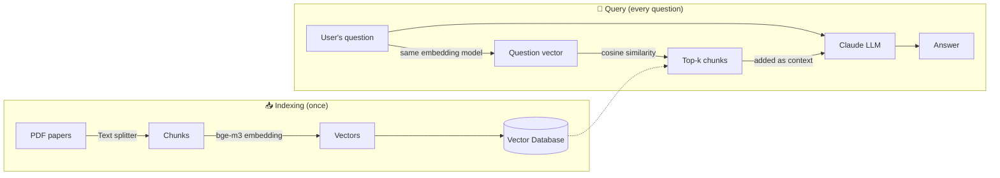

# 🏸 Chatbot-with-LangChain


A chatbot built with a **RAG (Retrieval-Augmented Generation)** pipeline using the LangChain framework. It answers questions **only** from your own PDF documents.

## 🔄 RAG Pipeline



## 🧩 Tech Stack

| Component | Choice |
|---|---|
| LLM | Claude (via Claude API) |
| Embedding model | `BAAI/bge-m3`, running locally |
| Vector store | FAISS (cosine similarity) |
| Text splitting | `RecursiveCharacterTextSplitter` or `SemanticChunker` |
| Framework | LangChain |

## ✂️ Chunking Strategies

| Splitter | How it splits | Best for |
|---|---|---|
| `RecursiveCharacterTextSplitter` | By structure and length (Markdown separators, paragraphs, lines, words) | Fast, predictable chunk sizes |
| `SemanticChunker` | By meaning: cuts where the topic changes (embedding distance) | Better topic coherence |

## 🚀 Getting Started

1. **Clone the repository**
   ```bash
   git clone https://github.com/<your-username>/Chatbot-with-LangChain.git
   cd Chatbot-with-LangChain
   ```
2. **Create a virtual environment** (recommended)
   ```bash
   python -m venv .venv
   source .venv/bin/activate      # Windows: .venv\Scripts\activate
   ```
3. **Install dependencies**
   ```bash
   pip install -r requirements.txt
   ```
4. **Add your API key** in a `.env` file:
   ```env
   ANTHROPIC_API_KEY=your_key_here
   ```
5. **Put your PDFs** into the `./paper` folder.
6. **Run** the script and ask a question:
   ```bash
   python main.py
   ```

> 💡 The first run downloads the `BAAI/bge-m3` model from Hugging Face, so it may take a few minutes.

## 📁 Project Structure

```text
.
├── paper/              # your PDF files
├── main.py             # RAG pipeline
├── requirements.txt    # Python dependencies
├── .env                # API key (not committed)
└── .gitignore
```
